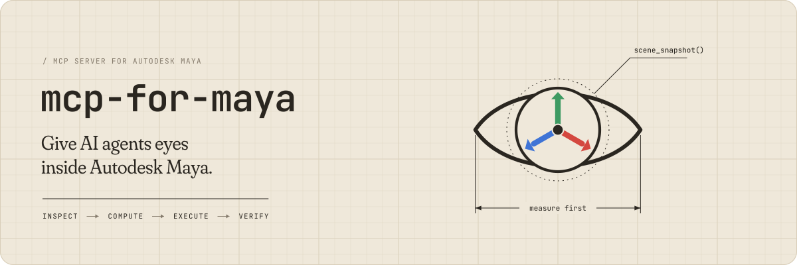
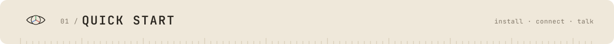

<!-- mcp-name: io.github.Xxx91n/mcp-for-maya -->

**English** | [简体中文](README.zh-CN.md)

<p align="center">
  
</p>

# mcp-for-maya

> MCP server that lets AI agents see what is actually in an Autodesk Maya scene

[](https://github.com/Xxx91n/mcp-for-maya/actions/workflows/ci.yml) [](https://pypi.org/project/mcp-for-maya/) [](https://github.com/Xxx91n/mcp-for-maya/blob/main/LICENSE) [](https://pypi.org/project/mcp-for-maya/)

## What this is

`mcp-for-maya` is a [Model Context Protocol (MCP)](https://modelcontextprotocol.io/) server that lets AI agents (such as Codex and Claude) drive Autodesk Maya: build models, plan scenes, and finish production work.

**Core capability:** AI no longer writes code blind. It can look at scene objects, materials, and how things sit in space at any time, then check its own changes against fixed rules.

> [!WARNING]
> This server runs Python code directly inside Maya by design, not by accident. For details, see [docs/threat-model.md](https://github.com/Xxx91n/mcp-for-maya/blob/main/docs/threat-model.md).



> For live captures and examples, see [docs/assets/showcase.md](https://github.com/Xxx91n/mcp-for-maya/blob/main/docs/assets/showcase.md).

### 1. Install

```bash
# Install from PyPI (recommended)
pip install mcp-for-maya

# Or run instantly with uvx without installing
uvx mcp-for-maya

# Alternative: install directly from git with uv
uv tool install git+https://github.com/Xxx91n/mcp-for-maya.git

# Or install from cloned source
git clone https://github.com/Xxx91n/mcp-for-maya.git
cd mcp-for-maya
pip install -e .
```

### 2. Connect Maya

#### Option A: Automatic setup (recommended)

Once the MCP server is running, the agent automatically calls `maya_setup_guide` to guide you through connecting:

1. Make sure Maya is open
2. Give the agent any instruction (like "check my Maya scene")
3. If not connected, the agent runs diagnostics and can install `userSetup.py` (merges safely with backup before writing)
4. Restart Maya, and the command port opens automatically

#### Option B: Manual setup

Run this in Maya's Script Editor:

```python
import maya.cmds as cmds

cmds.commandPort(name=":7001", sourceType="python")
```

> **Tip**: Open Script Editor via Maya menu → Windows → General Editors → Script Editor. Make sure the tab language is set to **Python** (not MEL).

#### Option C: Persistent auto-connect

Save the following code as `userSetup.py` in your Maya scripts folder:

| Platform | Path |
|----------|------|
| Windows | `%MAYA_APP_DIR%\<version>\scripts\` |
| Linux | `~/maya/<version>/scripts/` |
| macOS | `~/Library/Preferences/Autodesk/maya/<version>/scripts/` |

```python
import maya.cmds as cmds

cmds.evalDeferred('cmds.commandPort(name=":7001", sourceType="python")', lowestPriority=True)
```

#### Multiple Maya instances

Each `commandPort` binds to a specific `host:port`. A second instance cannot use the same port, so **each Maya instance must use its own port**. Typical layout:

| Maya instance | commandPort | Notes |
|---------------|-------------|-------|
| Instance A | `:7001` python | Main workspace |
| Instance B | `:7002` python | Second instance |
| Instance A | `:7011` mel | MEL port (identified once, then never probed again) |

Run `cmds.commandPort(name=":<port>", sourceType="python")` in each instance's Script Editor (or each one's `userSetup.py`). **Auto-scan** is the primary method — the server regularly scans local Maya listening ports and sets up connections. If an instance is missed, call `add_session(host, port)` manually. If port scanning touches other local TCP services, set `MAYA_MCP_INCLUDE_PORTS=7001,7002` (comma-separated, ranges like `7005-7010` supported) to limit the scan, or use `MAYA_MCP_EXCLUDE_PORTS=<port>` to ignore specific ports.

Note: A `commandPort` **does not persist across sessions** — it closes when Maya quits. To keep it persistent, add it to `userSetup.py` (Option C).

#### Troubleshooting

| Issue | Solution |
|-------|----------|
| `list_sessions` returns empty | Run `maya_setup_guide(action="diagnose")` |
| Port already in use | Close the other Maya instance or pick another port |
| userSetup.py does not run | Check that the file is in the right scripts folder, then restart Maya |
| Blocked by firewall | Make sure localhost:7001 can be accessed locally |
| Second Maya instance not found | Each instance needs its own port (same port causes bind conflicts); if scanning still misses it, use `add_session(host, port)` |
| Script Editor spams syntax errors | An older symptom of scanning MEL ports. Current versions identify a non-Python port once and then stop probing it; if it still happens, exclude the port with `MAYA_MCP_EXCLUDE_PORTS` |

### 3. Configure your MCP client

Codex `~/.codex/config.toml`:

```toml
[mcp_servers.maya]
command = "uvx"
args = ["mcp-for-maya"]
tool_timeout_sec = 120
```

For git source installs: `args = ["--from", "git+https://github.com/Xxx91n/mcp-for-maya.git", "mcp-for-maya"]`. For local source builds, set `command = "python"`, `args = ["-m", "maya_mcp_server"]`, and point `PYTHONPATH` to `<repo>/src` in `env`.

### 4. Start using it

Chat naturally in your agent:

> "Check out what's in my Maya scene, then put together a display shelf by the entrance"

The AI calls `scene_snapshot()` to see the scene, builds the model, then checks the result with `scene_review()`.


Every scene edit follows **ICEV**: look at the scene, work out the change, make the change, then check the result — in that order, every time. The same four steps are also an agent skill card in `skills/icev-workflow`:

```
┌──────────┐     ┌──────────┐     ┌──────────┐     ┌──────────┐
│ INSPECT  │ ──→ │ COMPUTE  │ ──→ │ EXECUTE  │ ──→ │ VERIFY   │
│ look     │     │ work out │     │  apply   │     │  check   │
└──────────┘     └──────────┘     └──────────┘     └──────────┘
```

1. **INSPECT** (look): Call `scene_snapshot()` to capture the scene's spatial data
2. **COMPUTE** (work out): Calculate positions, sizes, and spacing from the spatial data
3. **EXECUTE** (apply): Run Maya Python code via `execute_code()`
4. **VERIFY** (check): Check the outcome with `scene_assert()` + `scene_review()`; GUI sessions can also look at the result


| Capability | Tools | Notes |
|------------|-------|-------|
| 🧊 **Spatial awareness** | `scene_snapshot` `scene_inspect` `scene_measure` | One call gets the objects, their types, world positions, and sizes. The size is the object's own bounding box, not scaled by the object or its parents, so a scaled-up object really is bigger than the number says. For a true world size of one object, call `scene_measure` with the same object as both `obj_a` and `obj_b` and `mode="bbox"`: it overlaps itself, so `details.overlap_dims` gives the three world-space axis extents (still box extents, not mesh surface). Measurements are all world-space axis-aligned bounding boxes: overlapping boxes can belong to shapes that do not touch, and rotated or concave shapes measure looser than they look. The default CoS output picks a listing cap that fits the scene size (50 on a small scene up to 1000 on a huge one), so in practice it drops nothing until the scene passes 1000 objects; past that it adds a `... N more objects` line before the `STATS:` line. `format="json"` has no cap, but the result is much bigger |
| 🎨 **Look quality** | `scene_aesthetics` | 5 dimensions: color balance (60-30-10), spatial composition (golden ratio / rule of thirds), proportion & scale (ergonomics), lighting quality (three-point setup, fill ratio, color temperature, decay), visual flow |
| 🎬 **Cameras** | `camera_create` `camera_orbit` | 8 built-in shot types + orbit animation |
| 🛡️ **Disaster recovery** | `scene_checkpoint` `scene_rollback` `scene_checkpoint_list` | Writes the scene to a `.ma` file on disk under `checkpoints/`; rollback opens that file and points the scene back at its original path |
| 🧠 **Scene planning** | `scene_plan` | Scene health checks, zone balance, layout tips, conflict prevention, natural-language planning. With `recommend_assets=True` it also lists Poly Haven models size-screened against a resolved target object (`0.5x–1.5x` per sorted axis) or falling back to the furniture zone's bounding box (`upper-limit` only) — not a clearance or collision verification; search only, nothing downloaded or imported. Off by default, and the output is then byte-identical to the plain plan |
| 📋 **Scene checks** | `scene_review` `scene_validate` `scene_assert` | 11 fixed checks (0-100 score) + your own constraint checks + scene assertions |
| ⚡ **Code execution** | `execute_code` `write_module` | Run arbitrary Python in Maya / inject reusable modules |
| 👁️ **Check by looking** | `scene_viewport_snapshot` `scene_render_preview` | Viewport screenshot of exactly what the artist sees, plus a one-frame playblast preview, so the AI can look at the result (GUI sessions only) |
| 🔌 **Session management** | `list_sessions` `add_session` `maya_setup_guide` | Multi-session discovery/attachment + setup diagnostics and installation guidance |
| 📦 **Asset library** | `asset_search` `asset_import` | Poly Haven CC0 models — downloads over HTTPS on the host (domain allowlist, MD5 check, size limits, local cache), Maya imports FBX with auto-wired textures, checks face count and size limits, and prevents duplicates via `GRP_asset_<id>` |
| 📤 **Scene export** | `scene_export` | Export whole scenes or selected objects to FBX/OBJ/USD; format auto-detected from file extension (no guesswork), auto-creates folders, explicit overwrite opt-in, restores selection afterward |
| 🔎 **Scene-graph inspection** | `scene_describe` `scene_nodes` | Tells you what a node is (exact types, per-attribute metadata such as type, enum choices, and ranges, and how it is wired, with a response size cap — `limit` can go to 1000, and a cut-off result says so via `*_truncated`) and lists nodes page by page, including materials and tool nodes; `has_more`/`next_cursor` do the paging. Attribute values are not included by default: pass `include_values=True` to get the current value of each attribute |

25 MCP tools in total.

## Tools in detail

### Spatial awareness

```python
# Full scene snapshot (one call returns spatial data for all objects)
scene_snapshot(detail="compact", format="cos")

# Inspect a specific object (including neighboring objects)
scene_inspect(target="wall_entrance", include_neighbors=True)

# Measurement (4 modes, on world-space bounding boxes)
scene_measure(obj_a="wall_north", obj_b="counter_A", mode="clearance")

# Verify scene state
scene_assert(expectations='{"wall": {"exists": true, "position": [0,0,500]}}')
```

### Scene checks

```python
# 11 fixed checks (returns 0-100 score)
scene_review()

# Spatial constraint validation
scene_validate(rules='[{"type": "min_clearance", "value": 180}]')
```

### Cameras

```python
# Create a camera (8 built-in shot types)
camera_create(target="product_display", shot_type="medium", azimuth=30, elevation=15)
# Types: extreme_wide / wide / medium / close / extreme_close / bird_eye / low_angle / over_shoulder

# Orbit animation camera
camera_orbit(center=[0, 100, 0], radius=500, frames=120)
```

### Disaster recovery

```python
# Save the scene to a .ma file on disk under checkpoints/ (no undo history)
scene_checkpoint(name="before_renovation")

# List all checkpoints
scene_checkpoint_list()

# Read a checkpoint back (it saves the current scene first, then points the scene name back at the original file; a scene that was never saved has no original file, so it stays in the checkpoint file; run scene_snapshot afterward to refresh scene state)
# Scope: each file is self-contained; references are flattened without modifying reference sources; assumes one scene file per session
# The result says scene_modified_before: whether the scene had unsaved changes
# at the moment this call read the flag. That flag blocks nothing: the copy
# taken before the switch is written exactly as before, and its path is in
# safety_snapshot (only a save that fails, with discard_current_state set,
# turns that into "skipped_by_user").
scene_rollback(filename="cp_before_renovation.ma")
```

### Assets (Poly Haven, host-side download)

```python
asset_search(query="camera", asset_type="models", limit=20)  # Search Poly Haven index
# Each result includes dimensions ([x, y, z] in metres, Poly Haven order) and polycount (int).
# Either is null when Poly Haven publishes no valid value. Search makes no file downloads.
asset_import(asset_id="Camera_01", resolution="1k")
# Downloads via HTTPS to local cache (MD5 verified + SHA-256 audit),
# then Maya imports the local FBX grouped under GRP_asset_<asset_id>
# (duplicate calls skip re-importing; force=True forces a re-import).
# Textures wire up automatically by file suffix
# (diff/rough/metal/nor_gl/ao/disp...), using sRGB/Raw color spaces and bump2d normals.
# Single-part assets with simple texture names (Diffuse/Rough/Metal...)
# are also recognized and connected to the asset's material.
# Limits: default 100k polygon cap (bypass with allow_high_polycount), dimension sanity check.
```

### Scene export

```python
scene_export(path="D:/out/scene.fbx")  # Full scene export; format inferred from .fbx extension
scene_export(path="/tmp/kit", format="obj")  # Missing extension gets appended -> kit.obj
scene_export(
    path="D:/out/kit.usd", objects=["GEO_box"]
)  # Export selected; restores selection afterward
# format in {fbx,obj,usd}: format and extension conflicts throw an error immediately, never guess.
# Existing files are protected unless overwrite=True. prompt=False is forced
# (avoids dialog popups that could freeze the connection); does not touch the scene dirty flag.
# Alembic is not supported (AbcExport is outside the cmds.file interface).
```

### Check by looking (GUI sessions only)

```python
# Viewport screenshot of exactly what the artist sees (includes HUD and selection highlights)
scene_viewport_snapshot(max_size=800, format="jpeg")

# Single-frame playblast preview (clean preview without HUD; supports camera selection, dimensions rounded up to multiples of 4)
scene_render_preview(camera="CAM_hero", width=640, height=360)

# Both tools return [image, JSON metadata]; headless sessions return a gui_session_required error
# Use format="png" for wireframe or line-art review; always rely on returned metadata for actual dimensions
```

## CoS output format

Default output uses **CoS** (Chain-of-Symbol) notation: scene data written as very short lines of text, which saves the number of tokens sent to the AI. The original research paper reports roughly 65% token savings compared to JSON on demo scenes (arXiv:2305.10276, -65.8%).

```
SCENE[164obj, 5zones] UNIT=cm UP=y MODIFIED=n
shell (23obj) @(-11.8,178.8,145.7)
  GRP_floor[mesh]@(0,0,0) 1121.5x20x1530.5
  pasted__arch_wall[mesh]@(0,0,0) 100x300x10
entrance (6obj) @(157.3,162.6,-111.6)
  GRP_workshopFront[group]@(1162,-17,103) 227.4x200.9x193.3
```

The first line always ends with `MODIFIED=y|n`: `y` means the scene has changes that were never saved, `n` means it has none. This is Maya's own flag for the whole scene. Changes made through the MCP tools count too, so the marker says whether anything changed, not who changed it. `scene_snapshot(format="json")` reports the same fact as the top-level `scene_modified` field, and it is read fresh on every call instead of coming from the object-list cache.

## Agent skills

The repository includes two **Experimental** skill cards (under the `skills/` folder):

| Skill | Purpose |
|-------|---------|
| `skills/icev-workflow` | ICEV discipline: every scene edit must look first, work out the change, apply it, then check the result |
| `skills/scene-review-playbook` | Check guide: scoring details for the 11 checks and how to turn findings into actions |


`scene_review()` provides 11 fixed checks (scores 0-100, normalized by rule weight):

| Check | Points | What it checks |
|-------|--------|----------------|
| spatial | 10 | Object, camera, and light counts |
| overlaps | 10 | Bounding box collisions (excluding parent-child) |
| conflicts | 10 | Object penetration checks |
| zones | 5 | Zone naming coverage |
| naming | 5 | Objects still carrying Maya default names |
| components | 10 | GRP_ grouping and hierarchy nesting depth <= 4 |
| orphans | 5 | Empty groups and default object names |
| aesthetics | 15 | 5 aesthetic dimensions (color, composition, scale, lighting, flow) |
| lighting | 10 | Three-point lighting, fill ratio, and decay |
| organization | 10 | Overall hierarchy health |
| constraints | 5 | Custom rule violations |

## Security & privacy

- **No telemetry**: nothing is tracked and nothing is phoned home. You can check this in the source. The only outgoing network calls come from the two asset tools, and only when you call them: they reach `api.polyhaven.com` / `dl.polyhaven.org|.com` over HTTPS, with the domain allowlist, MD5 check, and size limits written in `polyhaven.py`.
- **Local single-user**: the command port binds to localhost only, and a connected MCP client is trusted not to mean harm.
- **Guards against slips**: one pipeline (`pipeline.py` + `security.py`) checks parameters, rate-limits calls (~100 calls/60s for reads, ~20 calls/60s for writes per session), scans patterns, and writes one JSON line per call, covering all 25 tools. The scan has two levels: a few precise patterns are blocked outright and the call fails with `[blocked_pattern]` (`os.system`, bare `subprocess`, and a handful of others with no false-positive history), while the broader patterns only record a warning. A call can also be rejected for other reasons — a rate limit, one of the `MAYA_MCP_DISABLE_*` flags, or `safe_mode` — and those carry their own error codes, so the code in the error tells you which one fired. It catches honest mistakes, not a client that means harm. For the complete threat model, see [docs/threat-model.md](https://github.com/Xxx91n/mcp-for-maya/blob/main/docs/threat-model.md).
- **Transactional safety**: `scene_checkpoint` and `scene_rollback` write the scene to a `.ma` file on disk and read it back on request (a checkpoint file keeps no undo history; file references are flattened).
- **Strict policy mode (optional)**: Set `MAYA_MCP_DISABLE_EXECUTE=1`, `MAYA_MCP_DISABLE_WRITE_MODULE=1`, or `MAYA_MCP_DISABLE_ARBITRARY=1` (disables all three) to remove code execution tools from `tools/list` and reject calls with `[policy_disabled]`. Read-only tools remain active. These guard against accidental misuse; they are not a hard boundary against a malicious agent, since an agent holding `execute_code` is already trusted. They only limit how much damage one mistake can do during demos, testing, or in CI sandboxes. See [docs/threat-model.md](https://github.com/Xxx91n/mcp-for-maya/blob/main/docs/threat-model.md) and error codes in [docs/guide/error-codes.md](https://github.com/Xxx91n/mcp-for-maya/blob/main/docs/guide/error-codes.md).
- **`safe_mode` code allowlist (optional)**: When `MAYA_MCP_SAFE_MODE=1` is set (off by default), code payload tools remain listed, but their `code` parameters must pass an allowlist checked on the parsed code, which denies everything else by default: imports are limited to standard packages (`maya`, `math`, `json`, `re`, `collections`, `itertools`, `functools`, `dataclasses`, `typing`), blocked builtin functions reject upon reference rather than just call (`eval`, `exec`, `open`, `__import__`, getattr, setattr, etc.), accessing `__builtins__` or dunder attributes is rejected, and unparseable input is rejected immediately. Blocked calls fail with `[safe_mode_rejected]`, reporting the violated rule ID and recording it in the call record. Successful calls return a `mode: "safe"` field, and the tool description adds a `Boundary:` notice. DISABLE flags take priority by removing tools first—safe_mode only restricts what stays. Like DISABLE flags, this guards against mistakes rather than deliberate attacks, and it is not a hard barrier. See [docs/threat-model.md](https://github.com/Xxx91n/mcp-for-maya/blob/main/docs/threat-model.md) and error codes in [docs/guide/error-codes.md](https://github.com/Xxx91n/mcp-for-maya/blob/main/docs/guide/error-codes.md).
- Vulnerability reporting: See [SECURITY.md](https://github.com/Xxx91n/mcp-for-maya/blob/main/SECURITY.md).

## Requirements

| Environment | Requirement |
|-------------|-------------|
| Host (runs the MCP server) | Python **>= 3.10** (`requires-python`); Windows / Linux / macOS |
| Injected helper (runs inside Maya) | Maya **>= 2023** (bundled Python >= 3.9, relies on `ast.unparse`; older versions will receive a clear error on injection) |
| Verified against | Maya **2024** GUI |

## Development

```bash
uv sync --frozen                  # Set up locked dev environment from uv.lock (or: pip install -e . --group dev, requires pip>=25.1)
python -m pytest tests/ -q       # Run tests
ruff check src tests             # Lint
mypy src                         # Type check
python -m maya_mcp_server -vv    # Run with DEBUG logging (-v=INFO, -vv=DEBUG)
```

For contribution workflow, see [CONTRIBUTING.md](https://github.com/Xxx91n/mcp-for-maya/blob/main/CONTRIBUTING.md); for changelog, see [CHANGELOG.md](https://github.com/Xxx91n/mcp-for-maya/blob/main/CHANGELOG.md).

## Credits

Forked from [chadrik/maya-mcp-server](https://github.com/chadrik/maya-mcp-server), retaining its [MIT](./LICENSE) license.
