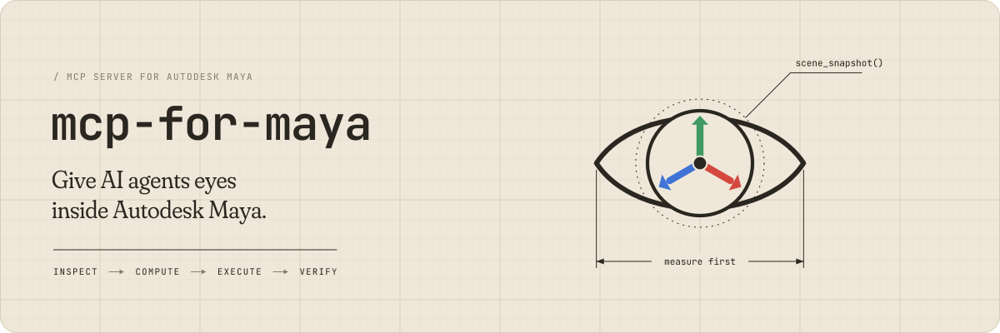

<!-- mcp-name: io.github.Xxx91n/mcp-for-maya -->

[English](README.md) | **简体中文**

<p align="center">
  
</p>

# mcp-for-maya

> 让 AI Agent 能真正看懂 Maya 场景的 MCP 服务器

[](https://github.com/Xxx91n/mcp-for-maya/actions/workflows/ci.yml) [](https://pypi.org/project/mcp-for-maya/) [](https://github.com/Xxx91n/mcp-for-maya/blob/main/LICENSE) [](https://pypi.org/project/mcp-for-maya/)

## 这是什么

`mcp-for-maya` 是一个 [Model Context Protocol (MCP)](https://modelcontextprotocol.io/) 服务器，让 Agent（Codex、Claude 等）直接操作 Autodesk Maya：建模、规划场景、把活干完。

**核心能力：** AI 不再是"闭眼写代码"，而是随时能看场景里有哪些物体、用了什么材质、彼此怎么摆，再按固定规则检查自己改得对不对。

> [!WARNING]
> 本服务器会使用 Python 代码在 Maya 中执行，这是设计能力而非漏洞。详见 [docs/threat-model.md](https://github.com/Xxx91n/mcp-for-maya/blob/main/docs/threat-model.md)。


> 实机效果见 [docs/assets/showcase_cn.md](https://github.com/Xxx91n/mcp-for-maya/blob/main/docs/assets/showcase_cn.md)。

### 1. 安装

```bash
# PyPI 安装（推荐）
pip install mcp-for-maya

# 或 uvx 免安装直跑
uvx mcp-for-maya

# 备选：用 uv 直接从 git 安装
uv tool install git+https://github.com/Xxx91n/mcp-for-maya.git

# 或克隆源码安装
git clone https://github.com/Xxx91n/mcp-for-maya.git
cd mcp-for-maya
pip install -e .
```

### 2. 配置 Maya 连接

#### 方式一：自动配置（推荐）

启动 MCP 服务器后，AI Agent 会自动调用 `maya_setup_guide` 工具引导连接：

1. 确保 Maya 已启动
2. 在 Agent 中输入任意指令（如"查看 Maya 场景"）
3. 如果未连接，Agent 会自动运行诊断并可安装 `userSetup.py`（只改自动维护的那段代码，重复执行结果一样，写入前自动备份）
4. 重启 Maya 后，命令端口自动打开

#### 方式二：手动配置

在 Maya 的脚本编辑器中执行：

```python
import maya.cmds as cmds

cmds.commandPort(name=":7001", sourceType="python")
```

> **提示**: Script Editor 打开方式：Maya 菜单 → Windows → General Editors → Script Editor；确保语言选择器为 **Python**（不是 MEL）。

#### 方式三：永久自动连接

将以下内容保存为 `userSetup.py`，放入 Maya 的 scripts 目录：

| 平台 | 路径 |
|------|------|
| Windows | `%MAYA_APP_DIR%\<version>\scripts\` |
| Linux | `~/maya/<version>/scripts/` |
| macOS | `~/Library/Preferences/Autodesk/maya/<version>/scripts/` |

```python
import maya.cmds as cmds

cmds.evalDeferred('cmds.commandPort(name=":7001", sourceType="python")', lowestPriority=True)
```

#### 多实例并行

`commandPort` 是绑死 `host:port` 的单监听 socket——同端口第二个实例 bind 会失败，因此**每个 Maya 实例需要自己的端口**。典型拓扑：

| Maya 实例 | commandPort | 说明 |
|-----------|-------------|------|
| 实例 A | `:7001` python | 主工作实例 |
| 实例 B | `:7002` python | 第二实例 |
| 实例 A | `:7011` mel | MEL 端口（自动识别后不再反复探测，不再刷错） |

在每个实例各自的脚本编辑器（或各自 `userSetup.py`）里执行 `cmds.commandPort(name=":<port>", sourceType="python")`。**自动扫描**是主路径——服务端周期枚举本机 Maya 监听端口并接入会话；扫不到时用 `add_session(host, port)` 手动兜底。若扫描误探本机其它 TCP 服务，可用 `MAYA_MCP_INCLUDE_PORTS=7001,7002`（逗号分隔，支持 `7005-7010` 区间）收敛探测范围，或用 `MAYA_MCP_EXCLUDE_PORTS=<port>` 排除特定端口。

注意：`commandPort` **不随会话持久**——Maya 重启即失效；持久化请写入 `userSetup.py`（见方式三）。

#### 故障排查

| 问题 | 解决方案 |
|------|----------|
| `list_sessions` 返回空 | 调用 `maya_setup_guide(action="diagnose")` |
| 端口被占用 | 关闭其他 Maya 实例，或换端口 |
| userSetup.py 不生效 | 确认文件在正确的 scripts 目录，重启 Maya |
| 防火墙拦截 | 确保 localhost:7001 可访问 |
| 第二个 Maya 实例不出现 | 每个实例需独立 `commandPort`（同端口 bind 冲突）；仍扫不到用 `add_session(host, port)` 手动添加 |
| Script Editor 反复刷语法错误 | 旧版探测 MEL 端口的症状：新版识别出非 Python 端口后就不再探测；仍异常时用 `MAYA_MCP_EXCLUDE_PORTS` 排除该端口 |

### 3. 配置 MCP 客户端

Codex `~/.codex/config.toml`：

```toml
[mcp_servers.maya]
command = "uvx"
args = ["mcp-for-maya"]
tool_timeout_sec = 120
```

走 git 源则 `args = ["--from", "git+https://github.com/Xxx91n/mcp-for-maya.git", "mcp-for-maya"]`。源码安装改用 `command = "python"`、`args = ["-m", "maya_mcp_server"]`，并在 `env` 中把 `PYTHONPATH` 指到 `<repo>/src`。

### 4. 开始使用

在 Agent 中直接对话：

> "帮我看看 Maya 场景里有什么，然后在入口处创建一个展示架"

AI 会调用 `scene_snapshot()` 看一遍场景，然后建模，再用 `scene_review()` 检查结果。


每次场景修改都走 **ICEV**：先看场景、再算方案、再动手改、最后复查，四步按顺序走。这四步也内置为 Agent 流程卡，见 `skills/icev-workflow`：

```
┌──────────┐     ┌──────────┐     ┌──────────┐     ┌──────────┐
│ INSPECT  │ ──→ │ COMPUTE  │ ──→ │ EXECUTE  │ ──→ │ VERIFY   │
│ 读场景    │     │ 算方案    │     │ 动手改    │     │ 复查结果  │
└──────────┘     └──────────┘     └──────────┘     └──────────┘
```

1. **INSPECT**（读场景）：`scene_snapshot()` 获取场景空间数据
2. **COMPUTE**（算方案）：基于空间数据计算位置、尺寸、间距
3. **EXECUTE**（动手改）：`execute_code()` 执行 Maya Python 代码
4. **VERIFY**（复查结果）：`scene_assert()` + `scene_review()` 确认结果；GUI 会话还可以直接看图


| 能力 | 工具 | 说明 |
|------|------|------|
| 🧊 **空间感知** | `scene_snapshot` `scene_inspect` `scene_measure` | 一次调用拿到物体、类型、世界位置和大小。这里的「大小」是物体自己的包围盒，没有算上它自己和父级的缩放，所以放大过的物体实际比这个数字大。要单独拿一个物体的真实世界尺寸，用 `scene_measure` 把同一个物体同时传给 `obj_a` 和 `obj_b`、`mode="bbox"`：它和自己必然重叠，`details.overlap_dims` 就是世界坐标下的三轴尺寸（还是盒子尺寸，不是网格表面）。所有测量都是世界坐标的轴对齐包围盒：两个形状没碰到，盒子也可能重叠；转过的或凹进去的形状，量出来会比看上去松。默认 CoS 输出按场景大小自己挑一个列出上限（小场景 50 个，超大场景 1000 个），所以实际上 1000 个以内一个都不会漏；超过 1000 才会在 `STATS:` 那行前面多出一行 `... N more objects`。要完全不设上限用 `format="json"`，但结果大很多 |
| 🎨 **画面质量** | `scene_aesthetics` | 5 维分析：色彩理论(60-30-10)、空间构成(黄金比例/三分法)、比例尺度(人体工学)、光照质量(三点照明/填充比/色温/衰减)、视觉动线 |
| 🎬 **相机** | `camera_create` `camera_orbit` | 8 种内置镜头类型 + 环绕动画 |
| 🛡️ **存档与读档** | `scene_checkpoint` `scene_rollback` `scene_checkpoint_list` | 把场景导出成磁盘上的 `.ma` 文件，放在 `checkpoints/`；读档时打开这个文件，再把场景指回原路径 |
| 🧠 **场景规划** | `scene_plan` | 组织健康检查、区域平衡、布局优化建议、冲突预防、自然语言规划。开 `recommend_assets=True` 后还会为入口、展示、家具和灯光区附上 Poly Haven 模型候选（`shell`、`ip_core`、`path` 跳过不搜），经过词级核对、去重和按区域包围盒尺寸粗筛——只是尺寸上限初筛，没有验证净空或碰撞；只搜索，不下载不导入；默认关闭，关闭时输出逐字节不变 |
| 📋 **场景检查** | `scene_review` `scene_validate` `scene_assert` | 11 项固定检查（0-100 分）+ 自定义约束检查 + 状态断言 |
| ⚡ **代码执行** | `execute_code` `write_module` | 在 Maya 中执行任意 Python 代码 / 注入可复用模块 |
| 👁️ **看图复查** | `scene_viewport_snapshot` `scene_render_preview` | 截一张视口图，看到的就是美术看到的那一帧（含 HUD 和选中高亮），另有单帧 playblast 预览，让 AI 看一眼改得对不对（仅 GUI 会话） |
| 🔌 **会话管理** | `list_sessions` `add_session` `maya_setup_guide` | 多会话发现/接入 + 连接诊断/安装/回退引导 |
| 📦 **资产库** | `asset_search` `asset_import` | Poly Haven CC0 模型——宿主侧 HTTPS 下载（主机白名单、md5 校验、大小上限、platformdirs 缓存），Maya 侧 FBX 导入带贴图自动接线、面数/尺寸上限检查、`GRP_asset_<id>` 去重 |
| 📤 **场景导出** | `scene_export` | FBX/OBJ/USD 导出——整场景或指定对象；格式按扩展名推断（冲突即报错不猜）、父目录自动创建、覆盖需显式 opt-in、导出后还原选择集 |
| 🔎 **场景图内省** | `scene_describe` `scene_nodes` | 讲清一个节点是什么（准确类型、逐条属性和它们的类型/可选值/取值范围、连到哪，响应有长度上限，`limit` 最高放宽到 1000，截断时经 `*_truncated` 说明），并按页列出节点（含材质和工具节点）；翻页用 `has_more`/`next_cursor`。属性当前值默认不返回，需要时传 `include_values=True` |

共 25 个 MCP 工具。

## 工具详解

### 空间感知

```python
# 全场景数据（一次调用，返回所有物体的空间数据）
scene_snapshot(detail="compact", format="cos")

# 深度检查特定物体（含邻居分析）
scene_inspect(target="wall_entrance", include_neighbors=True)

# 测量（4 种模式，按世界坐标包围盒算）
scene_measure(obj_a="wall_north", obj_b="counter_A", mode="clearance")

# 验证场景状态
scene_assert(expectations='{"wall": {"exists": true, "position": [0,0,500]}}')
```

### 场景检查

```python
# 11 项固定检查（返回 0-100 分）
scene_review()

# 空间约束验证
scene_validate(rules='[{"type": "min_clearance", "value": 180}]')
```

### 相机

```python
# 创建相机（8 种内置镜头类型）
camera_create(target="product_display", shot_type="medium", azimuth=30, elevation=15)
# 类型：extreme_wide / wide / medium / close / extreme_close / bird_eye / low_angle / over_shoulder

# 环绕动画相机
camera_orbit(center=[0, 100, 0], radius=500, frames=120)
```

### 存档与读档

```python
# 存档（把当前场景导出成磁盘上的 .ma 文件，不含 undo 历史）
scene_checkpoint(name="before_renovation")

# 列出所有存档
scene_checkpoint_list()

# 读档（先自动存一份当前场景，再把场景名指回原文件；没保存过的场景没有原文件，读档后就停在这个存档里；读档后请用 scene_snapshot 重建认知）
# 边界：每个存档都自包含——references 默认展平不回写；假定单场景文件单会话
# 读档结果里还有 scene_modified_before：这次调用读标记那一刻有没有没保存的改动。
# 这个字段不拦任何操作；副本照旧写，路径在 safety_snapshot 里
# （只有 discard_current_state 能在写失败时把它变成 skipped_by_user）。
scene_rollback(filename="cp_before_renovation.ma")
```

### 资产（Poly Haven，宿主侧下载）

```python
asset_search(query="camera", asset_type="models", limit=20)  # Poly Haven 索引检索
# 每条结果都带 dimensions（[x, y, z]，单位米，Poly Haven 原始顺序）和 polycount（整数）。
# 平台没有发布有效值时为 null。搜索不会下载任何文件。
asset_import(asset_id="Camera_01", resolution="1k")
# 经 HTTPS 下载到 platformdirs 缓存（逐文件 md5 校验 + sha256 审计），
# 然后 Maya 导入本地 FBX 并挂到 GRP_asset_<asset_id>（重复调用自动去重；
# force=True 强制重导）。贴图按文件名后缀自动接线
# （diff/rough/metal/nor_gl/ao/disp...），sRGB/Raw 色彩空间 + bump2d 法线。
# 单件资产使用裸贴图名（Diffuse/Rough/Metal...）——同样被识别并接到
# 该资产的唯一材质上。
# 上限检查：默认 100k 面数上限（allow_high_polycount 可放宽）、尺寸合理性检查。
```

### 场景导出

```python
scene_export(path="D:/out/scene.fbx")  # 整场景导出；按 .fbx 扩展名推断格式
scene_export(path="/tmp/kit", format="obj")  # 缺扩展名按显式 format 追加 -> kit.obj
scene_export(path="D:/out/kit.usd", objects=["GEO_box"])  # exportSelected；导出后还原原选择集
# format ∈ {fbx,obj,usd}：扩展名与显式 format 冲突即报错，绝不猜。
# 目标已存在时拒绝，除非 overwrite=True。prompt=False 强制
# （模态对话框会挂死命令通道）；不触碰场景 modified 脏标志。
# 不支持 Alembic——AbcExport 不是 cmds.file 面。
```

### 看图复查（仅 GUI 会话）

```python
# 截一张视口图，看到的就是美术看到的那一帧（含 HUD 和选中高亮）
scene_viewport_snapshot(max_size=800, format="jpeg")

# 单帧 playblast 预览（干净无 HUD；可指定相机，width/height 服务端向上取整 /4）
scene_render_preview(camera="CAM_hero", width=640, height=360)

# 两工具返回 [图片, JSON 元数据]；headless 会话返回 gui_session_required 错误
# wireframe/线稿审查建议 format="png"；实际尺寸以返回元数据为准
```

## CoS 输出格式

默认输出使用 **CoS**（Chain-of-Symbol）格式：把场景数据写成很短的一行行文字，省下发给 AI 的字数。该格式论文报告在其演示场景上较 JSON 节省约 65% token（arXiv:2305.10276，-65.8%）。

```
SCENE[164obj, 5zones] UNIT=cm UP=y MODIFIED=n
shell (23obj) @(-11.8,178.8,145.7)
  GRP_floor[mesh]@(0,0,0) 1121.5x20x1530.5
  pasted__arch_wall[mesh]@(0,0,0) 100x300x10
entrance (6obj) @(157.3,162.6,-111.6)
  GRP_workshopFront[group]@(1162,-17,103) 227.4x200.9x193.3
```

第一行末尾固定带 `MODIFIED=y|n`：`y` 表示场景里有没保存的改动，`n` 表示没有。这是 Maya 自己记的「改过没有」开关，管的是整个场景。通过 MCP 工具做的改动也算在内，所以这个标记只说有没有变过，不说谁改的。`scene_snapshot(format="json")` 用顶层 `scene_modified` 字段报同一件事，而且每次调用都现读，不走对象列表的缓存。

## Agent Skills

仓库内置 2 张 **Experimental** 流程卡（`skills/` 目录）：

| Skill | 用途 |
|-------|------|
| `skills/icev-workflow` | ICEV 修改纪律：任何场景变更都必须先看、再算、再改、再复查 |
| `skills/scene-review-playbook` | 检查手册：11 项检查的分值解读与 findings→actions 映射 |


`scene_review()` 提供 11 项固定检查（0-100 分，按各项分值归一化）：

| 检查 | 分值 | 检查内容 |
|------|------|----------|
| spatial | 10 | 物体/相机/灯光计数 |
| overlaps | 10 | BBox 碰撞检测（排除父子） |
| conflicts | 10 | 空间穿透检测 |
| zones | 5 | 命名规则区域覆盖 |
| naming | 5 | 还在用 Maya 默认名的物体 |
| components | 10 | GRP_ 分组 + 嵌套深度 ≤4 |
| orphans | 5 | 空组/默认名检测 |
| aesthetics | 15 | 5 维审美（色彩/构成/比例/光照/动线） |
| lighting | 10 | 三点照明/填充比/衰减 |
| organization | 10 | 层级组织健康度 |
| constraints | 5 | 自定义约束违反 |

## 安全与隐私

- **零遥测**：没有埋点，不往外上报任何东西——源码里可以自己查。唯一的外网请求来自两个资产工具：只有你调用它们时，才会经 HTTPS 访问 `api.polyhaven.com` / `dl.polyhaven.org|.com`（`polyhaven.py` 里限定了域名、校验 md5、限制大小）。
- **本地单用户**：命令端口仅绑定 localhost；接入的 MCP client 可信，假定它不会故意作恶。
- **防手滑措施**：统一管线（`pipeline.py` + `security.py`）对全部 25 个工具做参数校验 + token-bucket 限流（读取类 ~100 次/60s、变更类 ~20 次/60s，按会话）+ 模式扫描 + 每个工具调用写一行的独立 JSONL 调用记录。扫描分两档：少数几条精确规则直接拦下，调用以 `[blocked_pattern]` 报错（`os.system`、裸 `subprocess` 等几条从没误报过的），其余更宽的规则只记一条警告。调用被拒也可能是别的原因——限流、`MAYA_MCP_DISABLE_*` 开关、或 `safe_mode`，它们各自有错误码，看报错里的码就知道是哪一条。它防误操作，不防恶意 client——完整模型见 [docs/threat-model.md](https://github.com/Xxx91n/mcp-for-maya/blob/main/docs/threat-model.md)。
- **事务安全**：`scene_checkpoint`/`scene_rollback` 把场景存成磁盘上的 `.ma` 文件，读档时打开它（存档不含 undo 历史，references 默认展平）。
- **严格策略模式（可选）**：设置 `MAYA_MCP_DISABLE_EXECUTE=1`、`MAYA_MCP_DISABLE_WRITE_MODULE=1` 或 `MAYA_MCP_DISABLE_ARBITRARY=1`（三者全禁），就能把跑代码的工具从 `tools/list` 里拿掉，调用时报 `[policy_disabled]`；只读工具不受影响。这些开关防的是手滑，挡不住存心作恶的 agent——手里有 `execute_code` 的 agent 本来就在信任范围内。它们能做的只是让 demo、误操作或 CI 沙箱里的一次失误坏得少一点。理由见 [docs/threat-model.md](https://github.com/Xxx91n/mcp-for-maya/blob/main/docs/threat-model.md)，报错码见 [docs/guide/error-codes.md](https://github.com/Xxx91n/mcp-for-maya/blob/main/docs/guide/error-codes.md)。
- **`safe_mode` 代码允许清单（可选）**：设置 `MAYA_MCP_SAFE_MODE=1`（默认关闭）后，两个代码载荷工具仍在 `tools/list` 中，但其 `code` 参数要先过允许清单（按解析后的语法树判断，默认全拒）：v1 import 根限 `maya`/`math`/`json`/`re`/`collections`/`itertools`/`functools`/`dataclasses`/`typing`，拒绝名单内建名——任何引用即拒绝而非仅调用（`eval`/`exec`/`open`/`__import__`/getattr/setattr/……）、`__builtins__` 引用与任何 `__dunder__` 属性访问；无法解析的输入同样拒绝（"无法判定即拒绝"）。拒绝以 `[safe_mode_rejected]` 报出（宿主 `isError` 失败）并点名触发的 rule id、记入调用记录的 `rejected`；成功响应携带 `mode: "safe"` 字段，工具描述增加一句 `Boundary:` 说明。DISABLE 标志先移除工具——safe_mode 只收紧留下的部分。和 DISABLE 标志一样：它防手滑，不防故意作恶，也不是硬边界。理由见 [docs/threat-model.md](https://github.com/Xxx91n/mcp-for-maya/blob/main/docs/threat-model.md)，逐码对照见 [docs/guide/error-codes.md](https://github.com/Xxx91n/mcp-for-maya/blob/main/docs/guide/error-codes.md)。
- 漏洞报告渠道见 [SECURITY.md](https://github.com/Xxx91n/mcp-for-maya/blob/main/SECURITY.md)。

## 环境要求

| 环境 | 要求 |
|------|------|
| 宿主（运行 MCP server） | Python **≥3.10**（`requires-python`）；Windows / Linux / macOS |
| Maya 侧注入（helper） | Maya **≥2023**（自带 Python ≥3.9，依赖 `ast.unparse`；低于此版本注入时会收到明确报错） |
| 实证版本 | Maya **2024** GUI |

## 开发

```bash
uv sync --frozen                  # 从 uv.lock 装锁定开发环境（备选 pip install -e . --group dev，需 pip>=25.1）
python -m pytest tests/ -q       # 测试
ruff check src tests             # lint
mypy src                         # 类型检查
python -m maya_mcp_server -vv    # DEBUG 日志运行（-v=INFO, -vv=DEBUG）
```

贡献流程见 [CONTRIBUTING.md](https://github.com/Xxx91n/mcp-for-maya/blob/main/CONTRIBUTING.md)；变更记录见 [CHANGELOG.md](https://github.com/Xxx91n/mcp-for-maya/blob/main/CHANGELOG.md)。

## 致谢

Fork 自 [chadrik/maya-mcp-server](https://github.com/chadrik/maya-mcp-server)，保留其 [MIT](./LICENSE) 版权声明。
