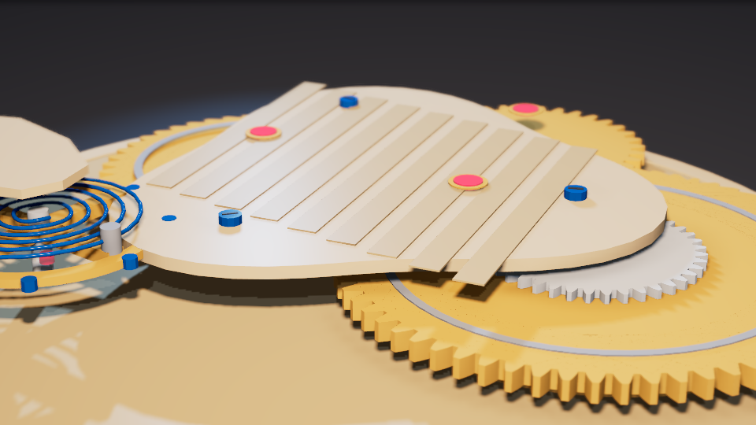
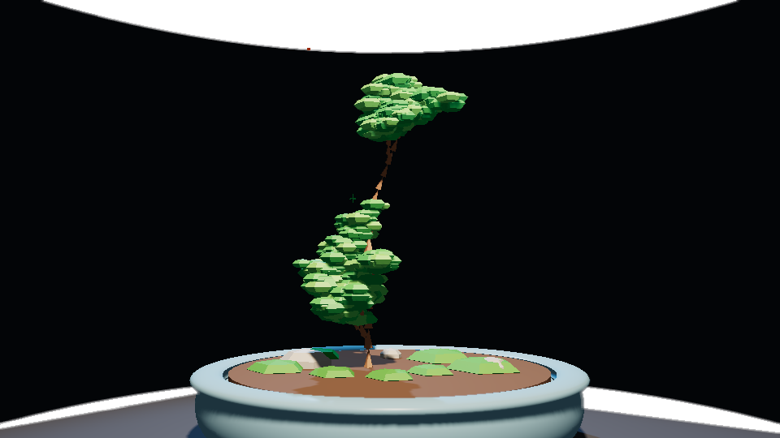
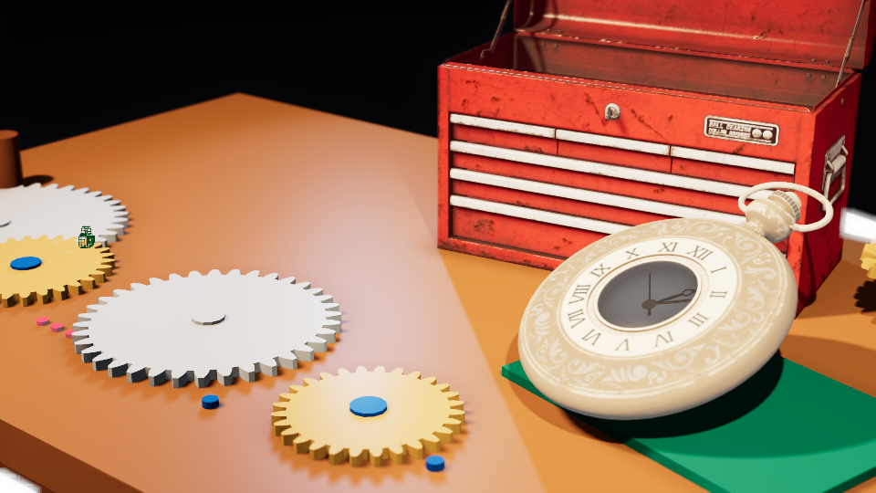
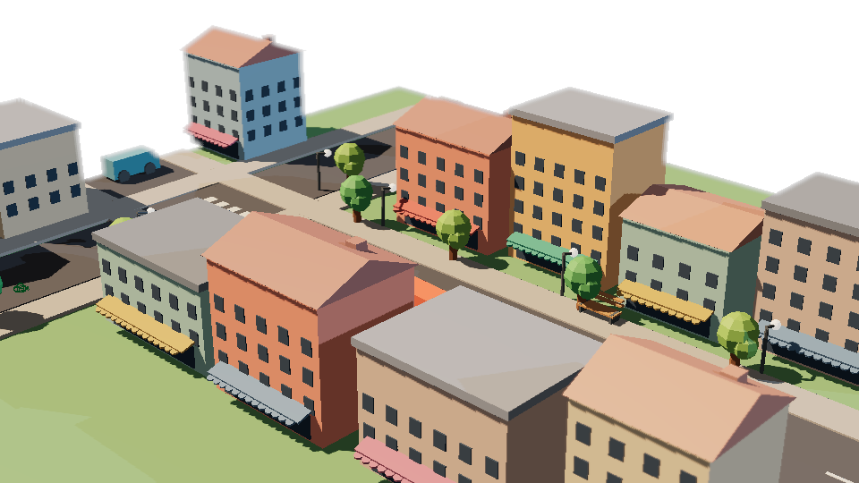
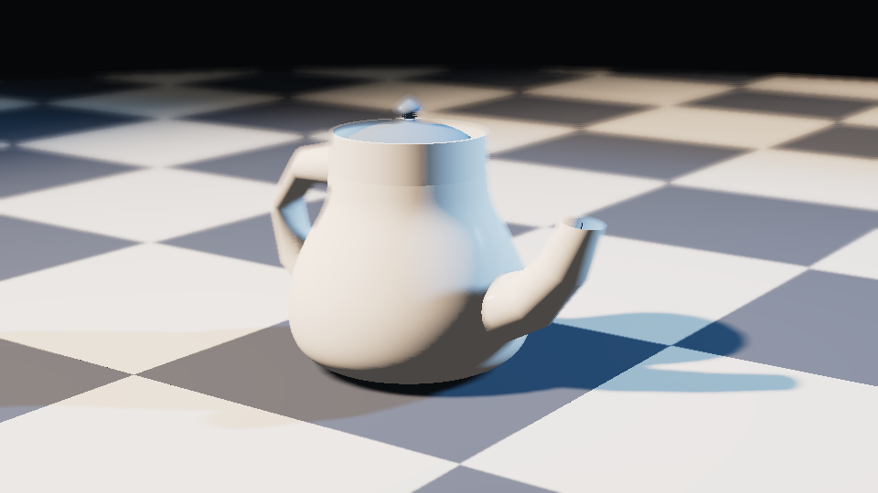
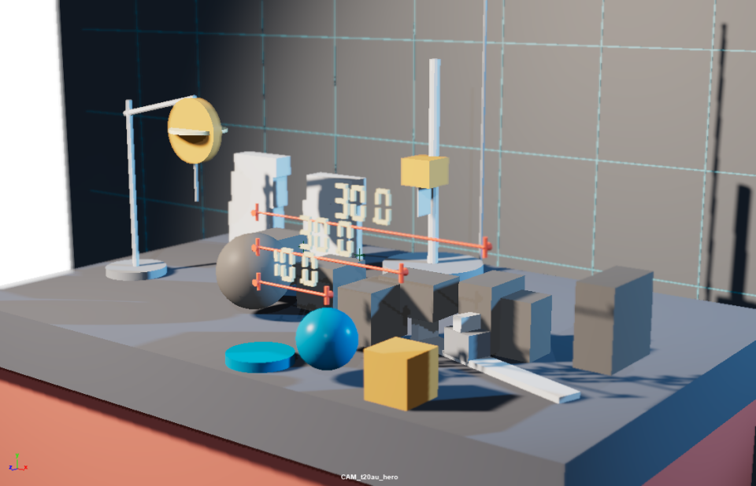
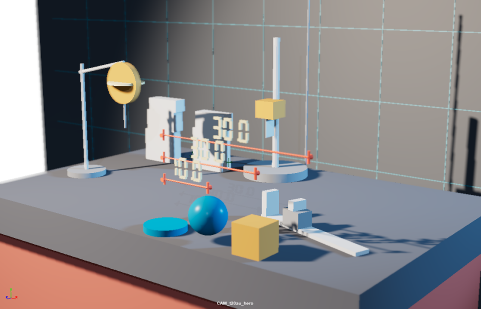
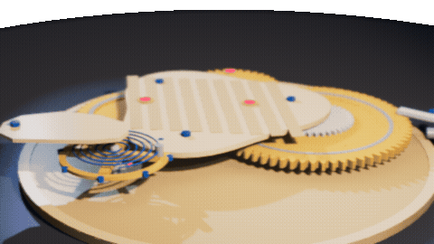

**English** | [简体中文](showcase_cn.md)

All media below were genuinely captured with the toolchain itself (no mockups): scenes were generated via `execute_code` / `write_module` (plus a real `asset_import`), preview frames were rendered through `scene_render_preview`, audit comparisons were captured using `scene_review` + `scene_viewport_snapshot`, and the orbit sequence was recorded frame by frame with `playblast` in a Maya 2024 GUI session.

| Prompt | Result |
|---|---|
| `write_module` → `t20_movement.build()` — "parametric involute gear caliber: true involute gear profile, Geneva stripes, heat-blued screws, ruby jewel bearings, spiral hairspring" |  |
| `write_module` → `t20_bonsai.build()` — "low-poly L-system bonsai tree: recursive branching, faceted leaf clusters, pot + moss + rocks" |  |
| `asset_import("vintage_pocket_watch")` + `asset_import("metal_tool_chest")` → `t20_workbench.build()` — "watchmaker workbench: imported assets with wired textures + procedural involute watch parts" |  |
| `write_module` → `t20_street.build()` — "low-poly street corner block: 11 parametric buildings, gable roofs, awnings, street furniture, parked vehicles" |  |
| `write_module` → `t20_teapot.build()` — "Utah teapot reproduction: lathe body profile, Bezier tapered spout, loop handle, checkerboard floor" |  |
| Running `scene_review()` on a cluttered workbench → `scene_plan(auto_fix=True)` + cleanup → re-running `scene_review()` — score jumped from **53.7 → 64.2** |  |

Every frame can be reproduced using the scripts under [`.github/assets-src/`](https://github.com/Xxx91n/mcp-for-maya/tree/main/.github/assets-src).
