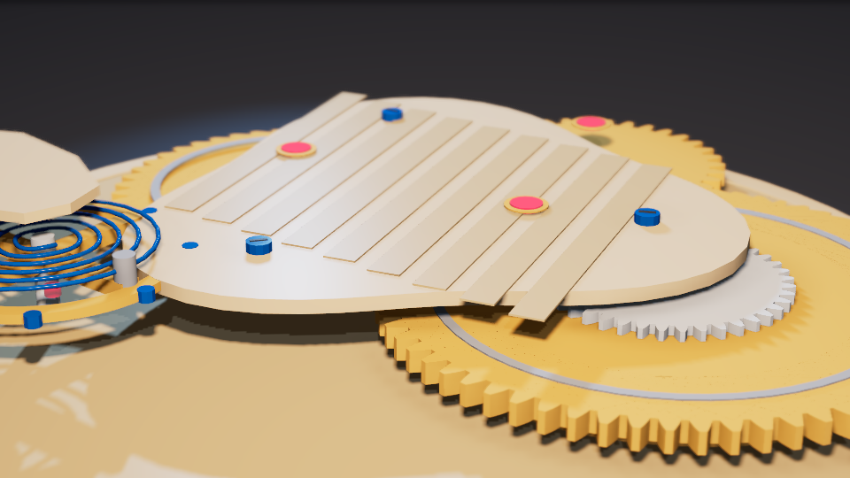
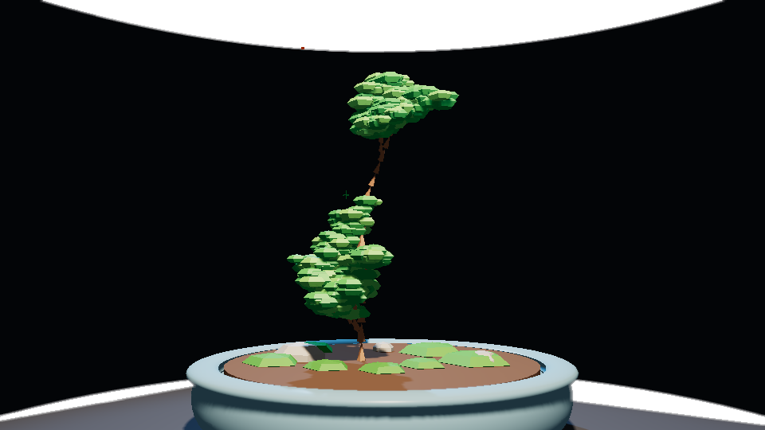
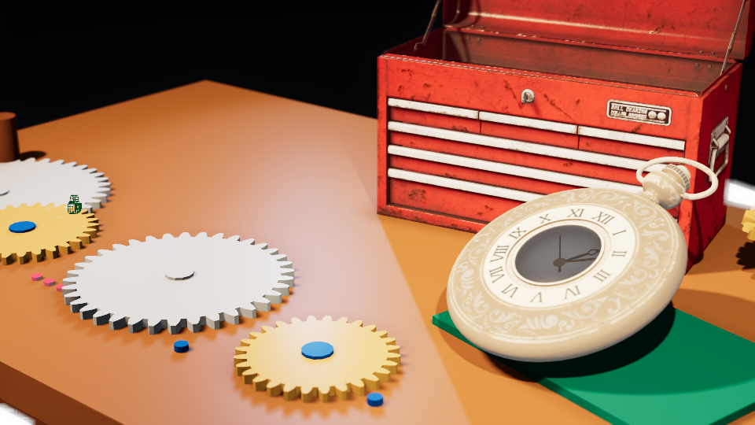
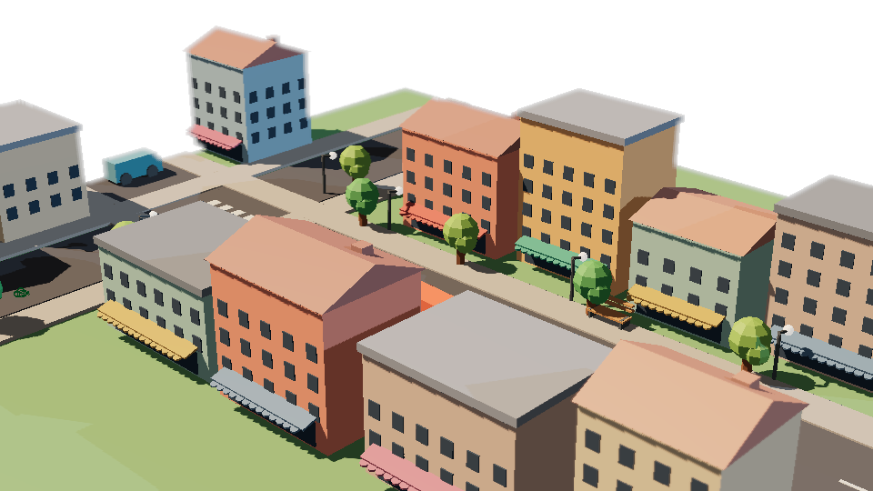
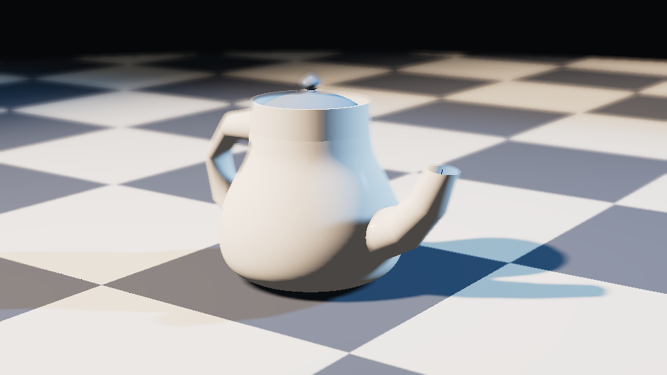
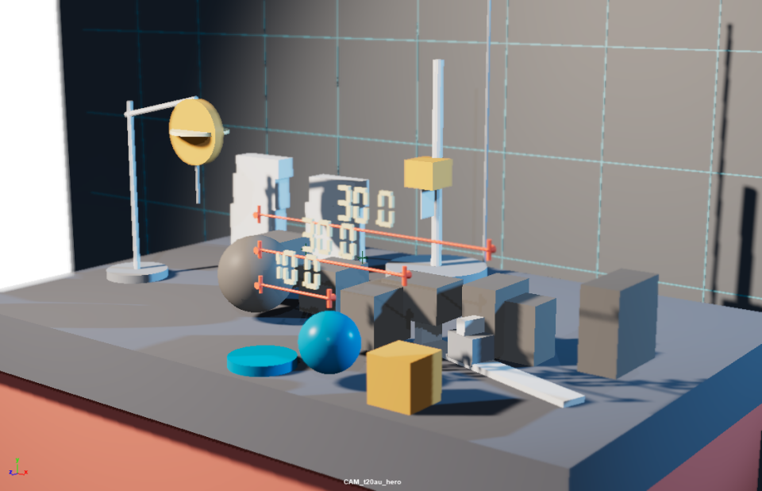
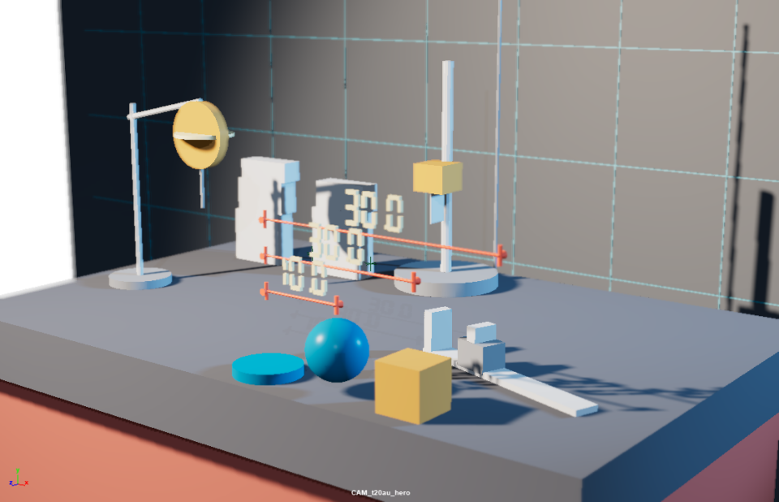
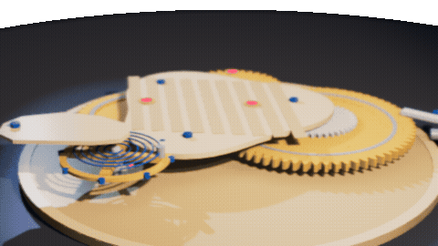

[English](showcase.md) | **简体中文**

下面这些东西全是用这套工具自己做出来的，没有拿假图充数。场景由 `execute_code` / `write_module` 建，另外真跑了把 `asset_import`。预览帧用 `scene_render_preview` 渲染。检查前后的两张图用 `scene_review` 加 `scene_viewport_snapshot` 截下来。环绕动画是在 Maya 2024 GUI 里用 `playblast` 一帧一帧录的。

| 指令 | 结果 |
|---|---|
| `write_module` → `t20_movement.build()`——"参数化渐开线钟表机芯：真渐开线齿形、日内瓦纹夹板、蓝钢螺丝、红宝石轴承、螺旋游丝" |  |
| `write_module` → `t20_bonsai.build()`——"low-poly L-system 盆景：递归分枝、切面叶团、盆+苔+石" |  |
| `asset_import("vintage_pocket_watch")` + `asset_import("metal_tool_chest")` → `t20_workbench.build()`——"钟表匠工作台：贴图接线的导入资产+程序化渐开线散件" |  |
| `write_module` → `t20_street.build()`——"low-poly 街角街区：11 栋参数化楼体、山墙屋顶、雨棚、街道家具、停放车辆" |  |
| `write_module` → `t20_teapot.build()`——"Utah 茶壶复刻：旋转轮廓壶身、贝塞尔锥形壶嘴、耳形把手、棋盘地面" |  |
| 在堆满乱件的台面上 `scene_review()` → `scene_plan(auto_fix=True)` + 清理 → 再 `scene_review()`——评分 **53.7 → 64.2** |  |

每一帧都可用 [`.github/assets-src/`](https://github.com/Xxx91n/mcp-for-maya/tree/main/.github/assets-src) 里的脚本复现。
